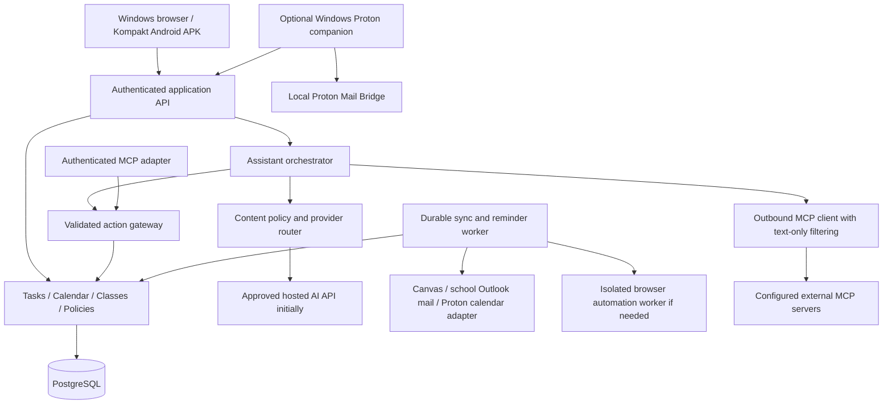

# Proposed architecture

Status: React/Vite, Fastify, npm workspaces and shared TypeScript/Zod contracts are implemented. The local planner includes owner authentication, common SQL migrations, PostgreSQL adapters, versioned tasks/calendar, occurrence exceptions, class/topic records, study blocks and a durable reminder worker/inbox. Browser offline snapshots/outbox and a provisional bundled Capacitor APK are implemented. AOSP emulator checks prove queued task edits survive force-stop and reconcile once through native HTTP/cookie authorization. Kompakt hardware, native alarms/background delivery, integrations, AI and MCP remain open gates. See [local development](development.md), [Android prototype](android.md) and [planner behavior](planner.md).

## Platform and stack direction

Prefer a shared React/TypeScript web interface, a TypeScript API and worker, and PostgreSQL. This keeps application contracts in one language while supporting structured academic and planning data.

Use the web app directly on Windows initially. Evaluate Capacitor for a sideloadable Android APK on Mudita Kompakt, including native local reminders and storage without Google Services. Defer the dedicated Windows UI and Tauri shell until the core app is complete. A separate local Bridge connector may still be needed earlier if Bridge remains on Windows. Separate shell adapters from shared application behavior.

Kompakt compatibility is a prerequisite to committing to the mobile framework: prove the bundled UI works in its installed WebView, offline mutations persist, and reminders behave on the actual firmware. If the shared WebView interface fails this gate, reconsider the Android presentation layer before building the full UI. See [target platforms](platforms.md).

These are proposals rather than proof of suitability. Capacitor officially targets Android, iOS, and web; a native Windows shell would be a separate adapter. Tauri supports Windows and mobile targets, but its platform capabilities still require testing. [Capacitor setup](https://capacitorjs.com/docs/getting-started/environment-setup), [Tauri](https://tauri.app/).

The current modular monolith runs the API and bounded reminder worker in one process, backed by PostgreSQL rows, leases and atomic delivery receipts. A separate synchronization/agent worker process and model-serving endpoint remain later options. No microservices or separate vector database are required for the current planner.

Confirmed initial target: Oracle Cloud Ubuntu Linux, 24 GB RAM and 4 OCPUs. Use bounded worker concurrency and verify CPU architecture before selecting browser/Bridge binaries. Measure resource use before claiming capacity. See [deployment and AI policy](deployment.md).



## Proposed repository layout

```text
apps/web/                shared browser UI
apps/api/                authenticated application API
apps/worker/             durable jobs and synchronization
apps/android/            mobile shell and native integrations
apps/windows/            deferred desktop UI; earlier Bridge companion only if needed
packages/domain/         planner rules and action policies
packages/contracts/      schemas and API contracts
packages/integrations/   provider adapters
packages/ui/             shared components and themes
docs/                    product and architecture decisions
```

Create only the packages needed by the first milestone; this tree is not a scaffolding requirement.

## Data model

| Entity | Important responsibilities |
| --- | --- |
| User / Device | Identity, preferences, device registrations, and isolation |
| Connection / SyncState | Provider account, encrypted credential reference, cursor, status, last success |
| Calendar / Event | Source, time zone, recurrence, all-day dates, cancellation, and occurrence exceptions |
| Task / TaskOccurrence | Deadline, priority, estimate, status, recurrence, source, and class/topic links |
| Reminder / Delivery | Trigger, target, device/channel, delivery state, and duplicate prevention |
| Course / Topic / Assignment | Academic portfolio and imported source facts |
| StudyPlan / StudySession | Available capacity, planned work, pinned sessions, completion, and explanation |
| EmailThread / EmailMessage | Provider identifiers, metadata, categories, source links, and optional content cache |
| Memory / MemorySource | Editable fact, scope, provenance, confidence, retention, and retrieval references |
| Action / Approval / Audit | Requested change, validated arguments, policy decision, execution, and outcome |

Use stable internal IDs and unique provider/account/external-ID mappings. Every user-owned record carries an owner; authorization is enforced server-side even for a single-user first version. Store times as instants with IANA time zones where relevant; store all-day dates as dates. Define recurrence and daylight-saving behavior before calendar implementation.

Keep imported source facts separate from personal overlays. For example, an assignment's provider deadline and a personal study target must not overwrite each other.

## Offline and synchronization

Confirmed Android offline scope: cached viewing and local edits, durably queued and sent to the server after reconnect. Schedule local reminders from available data. AI, fresh provider data, and provider-side execution need connectivity. Web/Windows offline parity remains a proposal.

- Use IndexedDB on the web; evaluate native SQLite through a storage adapter for packaged apps.
- Queue local mutations with unique operation IDs and expected server versions.
- Persist the queue across process death and restarts. Keep local pending changes visible until acknowledged; do not drop them on network or authentication failures.
- Separate local-to-server acknowledgement from subsequent provider-write completion. Recheck current permissions, provider capabilities, and source versions before executing queued external changes.
- Make server operations idempotent; use a server change cursor and deletion tombstones for reconciliation.
- Reject conflicting edits with an explicit resolution path rather than silently overwriting changes.
- Provider adapters declare read/write capabilities and freshness guarantees. Use bounded retries, backoff, and per-account concurrency limits.
- Use transactional job creation so a committed change cannot lose its required sync or reminder job.
- When a provider write times out, reconcile its outcome before retrying a non-idempotent operation.
- Disconnecting cancels queued provider actions and revokes/removes credentials; explain whether imported records are retained or deleted.

## Notifications

Native Android reminders should be scheduled locally from available data. Kompakt does not provide Google Services, so Google Play Services/FCM must not be a required delivery path. Initial synchronization uses foreground/reconnect refresh and best-effort OS-scheduled background work. Non-Google push is a later option requiring a device test; never promise immediate background updates before this is proven. Web notifications require a service worker and browser support. Dedicated Windows closed-app delivery is deferred with the desktop shell.

Designate how devices deliver each reminder and deduplicate locally scheduled and push-triggered copies. Reconcile schedules after edits, reconnect, clock/time-zone changes, and reboot. Show blocked permissions and stale schedules. Do not claim delivery while a device is powered off or after user force-stop.

Android alarm permissions and power policies affect timing; exact alarms require appropriate access. [Android alarm documentation](https://developer.android.com/develop/background-work/services/alarms).

## AI execution and hosting

The model proposes typed actions. Deterministic server code authenticates the owner, validates arguments and current versions, checks policy and limits, and executes them. A model-generated statement of success is not an execution receipt.

Initial policy: calendar writes execute without per-action user approval on supported writable connections; sending email always requires explicit approval. Model policy by action, connection, and outgoing side effects so settings can become configurable later. Log automatic changes and provide supported undo. Approval to use an account is separate from approval to send a particular email.

Calendar operations can generate invitation/update/cancellation emails. Classify those side effects before execution and require the email-send approval path unless the adapter has verified suppression support. Unattended calendar writes should not implicitly communicate with other people.

Email, course pages, attachments, retrieved text, and MCP tool results are untrusted data. They cannot change permissions. Never give the model direct database credentials or unrestricted shell/network access.

Where approval is required, bind it to the exact action payload, object versions, expiry, and user. Re-preview changed data. Automatic calendar operations still validate current versions and retry/re-plan conflicts without silently overwriting a user's change. Return completed, failed, or partially completed steps honestly; external operations are not universally reversible.

Confirmed: run orchestration on the existing server and call a hosted AI API initially. The server does not currently have the compute needed for model inference. The owner's laptop-hosted models are not a required service dependency. Abstract the model endpoint to permit future self-hosting after a quality/latency/concurrency benchmark and GPU budget review.

Hosted AI may receive relevant email bodies and Canvas content as text only. Screenshots and attachments are excluded, including attachment-derived text, OCR, tool results, and retrieval/embedding inputs. API provider, numeric limits, and retention remain open. Distinguish data reaching the hub server from data sent onward to the hosted provider.

Minimize routine spend with rules, incremental processing, policy-aware caching, and inexpensive models validated on representative tasks. Stronger models may handle complex planning or difficult extraction within configured limits. Meter costs by feature; willingness to spend more does not establish unlimited spending authority.

## AI provider routing

All model calls pass through a server-side egress gateway. Apply content exclusions, owner-applied source/content labels and their inherited provenance, permitted-provider rules, and only then cost/quality selection. No heuristic or model infers sensitivity. Unlabeled content follows the configured default route. A sensitive route is a permission decision, not an error fallback.

Re-evaluate before every call, including after retrieval or tool execution. Preserve source sensitivity on memory, summaries, and cached results; do not carry private conversation history into a default-provider request. Restrict hosted embedding/classification services in the same way. The default provider cannot be used to classify text it is not already allowed to receive.

Unavailable or incompatible approved destinations produce a queued/blocked result. Never broaden permissions during retries. Exact profiles, rule precedence, audit metadata, and acceptance cases are defined in [AI permissions and routing](ai-permissions.md).

## Browser automation adapter

The owner previously used model-driven computer use for Canvas assignments/alerts, Outlook mail inspection, and Proton Calendar access. Preserve this as a candidate fallback when direct APIs cannot supply required capabilities.

Run it in a separate bounded worker with provider-specific browser profiles, a verified browser-control runtime, and durable jobs. Existing computer-use skills in a development session do not automatically exist in the deployed app. Choose and deploy that runtime explicitly; confirm server resource needs and which hosted model supports the required tool loop.

Hosted model input is bounded text and structured DOM/accessibility descriptions of allowed pages/controls, never screenshots. Browser code uses stable locators and verifies results. If visual-only information is required or usable controls cannot be extracted, report unsupported coverage; do not switch to screenshot-driven computer use. Earlier computer-use success does not prove this text-only fallback works.

Keep session credentials out of model context. Pause on MFA/login challenges or changed UI rather than blindly retrying. Read back provider state after writes. A timeout can leave the result unknown; reconcile before repeating a create/update. Do not cache screenshots or page content in unrestricted logs.

Browser-derived records need source links and extraction confidence; UI changes can make extraction incomplete. Prefer API/feed data when available and reconcile browser enrichment to the same source IDs. Execute calendar writes only through the action gateway, including email side-effect checks. Do not enable automated assignment submission or unrestricted browser actions as part of the read-only academic connector.

Use minimum necessary context, per-request limits, daily spending/compute limits, timeouts, and a non-AI fallback. Start memory retrieval with structured records and text search; add embeddings only when retrieval quality justifies them.

## MCP in both directions

Inbound: external assistants use authenticated hub tools through the same action gateway. Calendar changes follow configured authority; email sends enter an explicit hub approval flow. Assistants cannot approve their own sends or grant additional permissions.

Outbound: built-in AI uses explicitly configured external MCP servers, initially a small allowlist with bounded tools, per-user credentials, destination restrictions, and action-policy checks. Both directions are requirements; arbitrary discovery remains later scope.

Normalize tool results before model context: permit approved bounded text and reject images, binary content, attachments, attachment-derived content, and disallowed resource links. Later resource fetches cannot bypass the filter. Inbound context exports enforce the same owner's content boundary.

MCP export permissions apply source sensitivity and destination rules too. A remote MCP server can receive private text even when the model provider is approved; independently check allowed fields/destinations before sending tool arguments. If an inbound client cannot establish an approved context destination, restrict sensitive exports.

## Privacy and operations

- TLS, encrypted persistent storage/backups, and separately protected connector credentials.
- No provider tokens or private message bodies in logs or analytics. Model requests contain only relevant approved text with credentials and unnecessary data removed.
- Relevant email/Canvas text is approved for hosted processing. Screenshots and attachments are excluded; changing this requires a new explicit user choice.
- Server-side AI needs plaintext at processing time; transport/storage encryption does not make it end-to-end encrypted against that server.
- Retention settings cover messages, conversations, memories, derived indexes, audit records, and backup expiry.
- Audit AI and integration changes; support export, disconnect, and deletion.
- Health/status views show sync age, queue failures, notifications, and AI availability.
- Separate development/staging/production, use synthetic fixtures, and verify backup restoration before relying on live data.

Threats requiring early tests: cross-user access, stolen tokens, prompt injection, duplicate writes, malicious calendar-feed URLs, and accidental disclosure through model context. If remote MCP/feed URLs are accepted, restrict destinations and redirects to prevent access to internal services.
